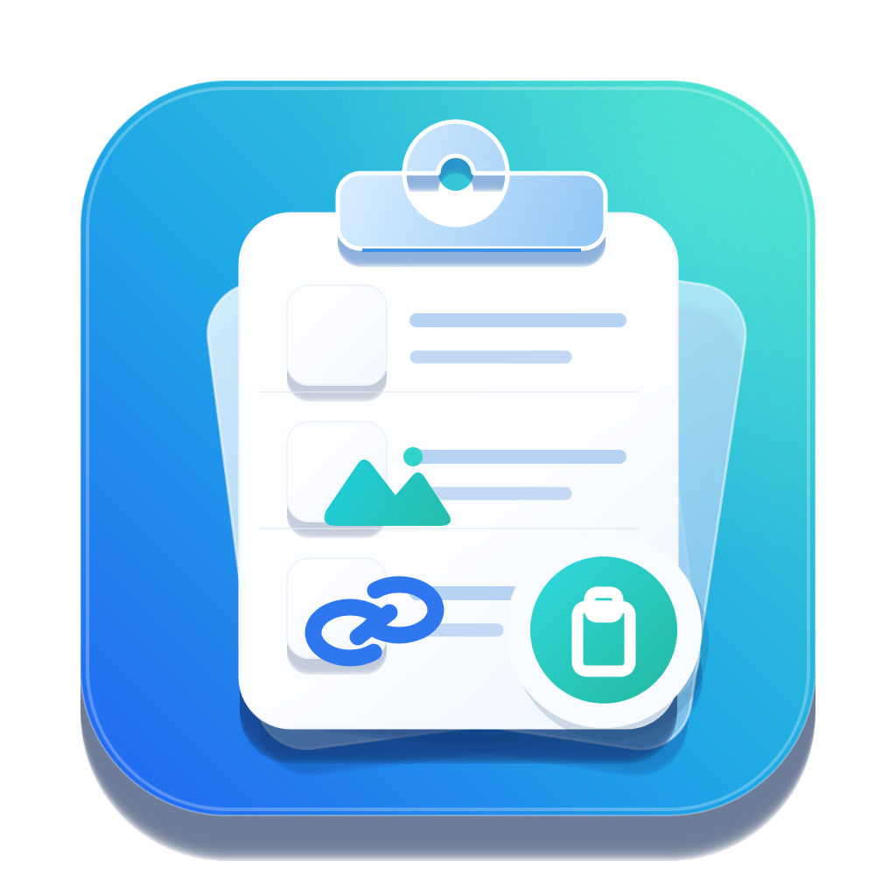

<p align="center">
  
</p>

# ClipNest

<p align="center">
  <b>现代化 Windows 剪贴板管理器</b><br/>
  自动记录你复制过的内容，随时呼出、一键粘贴，让复制粘贴快如闪电。
</p>

<p align="center">
  
  
  
  <a href="https://github.com/fancha0/ClipNest/releases/latest"></a>
  <a href="https://github.com/fancha0/ClipNest/releases"></a>
</p>

---

ClipNest 常驻后台，安静地记录你复制过的**文字、图片、文件、网页富文本、图文混排**等。需要时按一下快捷键即可呼出面板，选择内容后**回车直接粘贴**到当前窗口。

所有数据保存在本机 SQLite 数据库，**不上传、不联网**（仅“检查更新”会联网）。

> 项目主页：<https://github.com/fancha0/ClipNest>

---

## ✨ 功能特性

- 📋 **剪贴板历史** — 自动记录文本、图片、文件、富文本、图文等内容
- 🗂️ **标签页分类** — 常用语、代码、地址、账号等分组管理
- ⚡ **快速粘贴** — 全局快捷键呼出，按 `1`~`9` 或回车直接粘贴到目标窗口
- 🔍 **全局搜索** — `Ctrl+F` 秒搜全部条目
- 📌 **置顶与备注** — 重要条目一键置顶，备注支持自定义颜色与字号
- 🎨 **主题风格** — 简约白 / 护眼豆沙 / 商务蓝灰 / 石墨夜 / 冰川蓝 / 雾松绿
- 🪟 **磨砂透明** — 半透明磨砂背景，可开“背景模糊”让桌面透出
- ⏯️ **记录开关** — 一键暂停 / 恢复剪贴板记录（设置 · 托盘 · 顶栏均可）
- 🔄 **应用内自动更新** — 检查更新 → 下载 → 自动安装并重启
- 💾 **数据管理** — SQLite 本地存储，支持打包导出 / 导入（`.fluxpkg`），换机无忧
- 🖥️ **系统托盘** — 常驻后台，随用随呼
- 🧩 **来源识别** — 条目可显示捕获来源应用，方便排查重复内容
- 🔒 **单实例运行** — 重复启动自动提示，避免多开冲突

---

## 💻 系统要求

- Windows 10 1809（build 17763）或更新版本，或 Windows 11
- 64 位系统（x64）
- 不支持 Windows 7 / 8 / 8.1 及 32 位系统

---

## 📦 安装

### 方式一：安装包（推荐）

1. 前往 [Releases](https://github.com/fancha0/ClipNest/releases/latest) 下载 **`ClipNest-Setup.exe`**
2. 双击运行，一路“下一步”即可
3. 安装后开始菜单出现 **ClipNest**，可在“设置 → 应用”中卸载

> 免管理员权限，默认安装到当前用户目录：`%LOCALAPPDATA%\Programs\ClipNest`
>
> 安装包会检测系统版本，Windows 10 1809 以下会被拒绝安装。

### 方式二：便携版

1. 下载 **`ClipNest-Windows.zip`**，解压到任意目录（无需安装）
2. 双击运行 **`ClipNest.exe`**

> 🔐 **首次运行提示“未知发布者”？** 个人开发工具未购买代码签名证书，属正常现象。点击「更多信息」→「仍要运行」即可。

---

## 🚀 快速上手

1. 启动后程序**驻留后台**（右下角托盘区有小图标）
2. 在任意软件里**正常复制**内容（`Ctrl+C`）
3. 按 **`Ctrl + Shift + V`** 呼出面板
4. 用鼠标点选，或按 `1`~`9`，或选中后按 `回车`，即可**自动粘贴**
5. 点击面板外部或再次按快捷键即可收起

---

## ⌨️ 快捷键

| 快捷键 | 功能 |
| :--- | :--- |
| `Ctrl + Shift + V` | 呼出 / 隐藏面板（可自定义） |
| `Ctrl + Shift + P` | 暂停 / 恢复剪贴板记录 |
| `Ctrl + F` | 聚焦搜索框 |
| `Ctrl + N` | 新建条目 |
| `1` ~ `9` | 直接粘贴列表第 N 条 |
| `Enter` | 粘贴当前选中条目 |
| `Esc` | 清除搜索 / 返回列表 |

> 全局快捷键可在「设置 → 通用」中自定义（至少需要一个修饰键）。

---

## 🧭 界面速览

| 区域 | 说明 |
| :--- | :--- |
| 左侧 | **分类标签**，点击切换分类 |
| 中部 | **内容列表**，选中后回车 / 双击即粘贴 |
| 顶部 | **搜索框**、新建、设置按钮 |
| 右上 | **监听开关**（灰色=记录中，红色“已暂停”=已暂停） |
| 标题栏 | 按住可**拖动窗口**，四边四角可**缩放** |

---

## ⚙️ 设置说明

- **通用**：快捷键、开机自启、剪贴板记录开关、记录到哪个分类
- **外观**：主题风格、磨砂透明、背景模糊、窗口/条目配色、字体大小
- **备注与置顶**：备注文字颜色与大小、置顶标记颜色
- **数据**：数据统计、导出、导入、打开数据目录、清空
- **关于**：版本信息、检查更新、诊断日志

> 默认使用半透明磨砂外观（会模糊背后的桌面）。若觉得过透或运行卡顿，可在「外观 → 显示 → 背景模糊」关闭。

---

## 🔄 自动更新

默认**启动时自动检查更新**：发现新版本时弹窗提示，一键下载、自动安装并重启。
也可手动检查：「设置 → 关于 → 检查更新」。

更新包优先从自有更新服务器下载，GitHub Releases 作为备用来源；安装包会校验完整性后自动替换并重启。

---

## ❓ 常见问题

<details>
<summary><b>数据存储在哪里？会联网吗？</b></summary>

数据保存在本机 `%APPDATA%\ClipNest\clipboard.db`（从早期版本升级的用户可能在 `%APPDATA%\CrossClipboard\`）。纯本地 SQLite 存储，除“检查更新”外不进行任何网络传输。
</details>

<details>
<summary><b>杀毒软件提示风险？</b></summary>

个人开发者应用未购买代码签名证书，可能被部分杀毒软件误报。将 ClipNest 所在目录加入信任区即可。
</details>

<details>
<summary><b>快捷键没有反应？</b></summary>

多半是被其他软件占用（例如 `Win+V` 是 Windows 自带的剪贴板历史）。请在「设置 → 通用」中更换快捷键。
</details>

<details>
<summary><b>为什么有些复制内容没有被记录？</b></summary>

请查看右上角监听开关是否显示“已暂停”。若是，点击一次或用 `Ctrl + Shift + P` 恢复即可。
</details>

<details>
<summary><b>如何迁移到新电脑？</b></summary>

旧电脑进入「设置 → 数据 → 导出」，得到 `.fluxpkg` 数据包；新电脑安装 ClipNest 后，在同一位置选择「导入」即可。
</details>

<details>
<summary><b>如何排查异常？</b></summary>

日志文件位于数据目录下的 `clipnest.log`，反馈问题时请附上相关日志片段。诊断日志可在「设置 → 关于 → 诊断日志」关闭，或设置环境变量 `CLIPNEST_DIAGNOSTIC_LOG=0` 后重启。
</details>

---

## 🛠️ 开发与构建

- **技术栈**：Python 3.13 · PySide6 · SQLite
- **数据目录**：`%APPDATA%\ClipNest\`

```powershell
# 源码运行（开发模式）
python main.py

# 运行测试
python -m unittest discover -s tests

# 打包 exe
.\scripts\build_windows.ps1

# 一键发版（打包 + 上传更新服务器 + 创建 GitHub Release）
.\scripts\release.ps1
```

### 项目结构

```text
clipboard_manager/
├── controller.py       # 业务协调
├── repository.py       # SQLite 数据层
├── services/           # 剪贴板、热键、粘贴、更新、单实例等服务
└── ui/                 # 主窗口、设置、条目绘制、图标、磨砂与窗口特效
tests/                  # 单元测试
installer/              # Inno Setup 安装包脚本
scripts/                # Windows 构建与发布脚本
```

---

## 📄 许可

本项目暂未选择开源许可证，代码仅供学习与个人使用。
